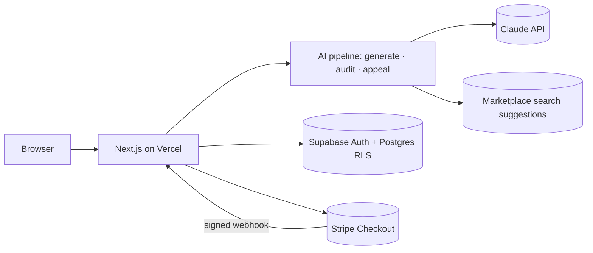

# Listing Copilot

**The compliance gatekeeper for cross-border sellers.** Sellers who don't write English natively (China, Vietnam, Korea, Latin America…) write product notes in their own language and get a listing for Amazon US, UK, DE, JP or TikTok Shop US, in the marketplace's language, with a takedown-risk score, every risky phrase explained in the seller's own language, and fixes that keep only the claims they can prove.

- **Live app:** https://listingcopilot.vercel.app
- **Stack:** Next.js 15 · TypeScript · Tailwind · Supabase (Auth + Postgres/RLS) · Claude API · Stripe (test mode) · Vercel
- **Docs:** [PRD and competitive analysis](docs/PRD.md) · [Architecture & design decisions](docs/ARCHITECTURE.md) · [Setup & deploy](docs/SETUP.md) · [Evaluation results](eval/RESULTS.md)

## Why it is different

Writing a listing with AI is no longer rare: Amazon offers it for free, and Helium 10 or Jungle Scout add keyword data. None of them is built for the seller's real fear, a takedown they can't understand, in a language they don't read.

| | Amazon's free AI | Helium 10 / Jungle Scout | **Listing Copilot** |
| --- | --- | --- | --- |
| Input in any language | partly | no | **yes** |
| Marketplaces | Amazon only | Amazon only | **Amazon US/UK/DE/JP + TikTok Shop** |
| Takedown-risk score before publishing | no | no | **yes, 0-100 with reasons** |
| Category rules (cosmetics, kids, pet, …) | no | no | **8 rule packs + phrase-combination rules** |
| Explanations in the seller's language + back-translation | no | no | **yes** |
| Claims tied to the seller's documents | no | no | **evidence library** |
| Audit and fix a live listing | rewrite only | optimization | **risk before → after, minimal fix** |
| Takedown notice → cause, fix, appeal | no | no | **yes** |

## What it does

**New listing** (5 steps, progress streamed to the page):

| Step | What happens | How |
| --- | --- | --- |
| 1. Extract | Notes in any language (+ photo) → English facts and a product category. Too thin → 1-4 questions in the seller's language, **no credit spent** | Claude, structured output |
| 2. Keywords | Facts + real phrases from the marketplace's search box → shopper keywords in the market's language. In parallel: main-image check (white background measured in the browser + vision review) | Claude + search suggestions |
| 3. Write | Title, 5 bullets, description, search terms; certifications only if the seller holds the document | Claude |
| 4. Check limits | Length, forbidden characters, word repeats, bullet count, search-term bytes (any script); one AI repair, then code enforces | TypeScript + Claude |
| 5. Review | Category rule pack + AI review (market-specific law) + fact check, risk score, then everything explained in the seller's language with a back-translation | Code + 3 Claude calls |

**Interface in 5 languages:** English, 简体中文, Tiếng Việt, Español, 日本語, picked from the browser and switchable from the header, even before signing in. AI explanations follow the chosen language.

**Also:** audit and fix a live listing · bulk CSV (50 rows) · takedown/appeal assistant · evidence library · free re-check of every listing when the rules are updated · section rewrite, manual edit, copy, CSV export.

**Account:** email verification by code, password reset, cancel Pro or update the card in Stripe's customer portal, download all data, delete the account (cancels the subscription first), Terms / Privacy / Refund pages, fair-use cap of 300 AI requests per 30 days.

**Pricing:** 3 free credits · $4.99 for 20 credits · $9.99/month unlimited (Stripe Checkout, test mode: card `4242 4242 4242 4242`). One credit = one listing, audit or appeal.

## Evaluation

`npm run eval` scores the rule layer on 64 hand-labelled phrases (no API calls): **45/45 risky phrases caught, 0/19 false alarms** on acceptable phrases such as "dog treats" or "perfect for camping". The set is a regression guard written alongside the rules, not an independent benchmark; see [eval/RESULTS.md](eval/RESULTS.md). Measured cost: about **$0.08 per listing** (Claude Opus 5.5, ~40 s).

## Architecture



Details, sequence diagram and the reasoning behind each choice: [docs/ARCHITECTURE.md](docs/ARCHITECTURE.md).

## Repository layout

```
src/
  app/                     pages and API routes (Next.js App Router)
    api/listings/          generate (streamed), edit, rewrite, explain, re-check, export (one or many)
    api/audit/ api/appeal/ audit a live listing (streamed); takedown help
    api/evidence/          the seller's document library
    api/checkout/ api/stripe/webhook/   Stripe Checkout and the verified webhook
    listings/ audit/ appeal/ bulk/ evidence/ dashboard/ pricing/ login/
  components/              risk badge, evidence picker, progress, buy buttons
  lib/
    ai/                    pipeline.ts (generate, audit, appeal, re-check), prompts.ts, claude.ts (SDK, retries, fallback)
    listing/               marketplaces, compliance rules and risk score, limit validator, input guard, search suggestions, schemas
    supabase/ server/      clients, streaming, LLM wiring
    account.ts billing.ts  credits, rate limits, Stripe event → action
supabase/migrations/       001 schema, RLS, credit/payment functions · 002 audits, evidence, appeals
tests/                     unit tests (fake model, no network)
eval/                      labelled set, scorer, RESULTS.md
docs/                      PRD, architecture, setup
```

## Reliability and safety

- **Errors never cost the seller:** a credit is spent only after step 1 succeeds and is refunded on any later failure.
- **Model output is validated:** JSON Schema structured outputs, zod validation, one retry, typed errors with user-facing messages; refusals fall back to another model server-side.
- **Hallucination control:** fact check against the extracted facts; AI findings must quote text that is really in the listing; claims need the seller's documents.
- **Prompt injection:** seller text is data in tagged blocks, instruction-like text is flagged (several languages), outputs are schema-bound, no tools.
- **Secrets:** server-side only (Vercel env vars); `.env.example` documents them.
- **Payments:** granted only by the signature-verified webhook, once per Stripe event; credit functions are not callable from the browser.
- **Abuse and cost:** per-user rate limits, rewrite cap per listing, token usage logged per step.

## Development

```bash
npm install
cp .env.example .env.local   # see docs/SETUP.md
npm run dev
npm run check                # type-check + lint + unit tests
npm run eval                 # rule-layer evaluation, writes eval/RESULTS.md
npm run build
```

## Next steps

- Publish directly through the Amazon SP-API / TikTok Shop API, and re-scan live listings on a schedule.
- Real search-volume data alongside the search-box suggestions.
- Held-out eval set from real takedown notices; an AI-layer eval with measured precision.
- Upload the evidence files themselves (Supabase Storage) and check their expiry dates.
- More marketplaces (Amazon FR/IT/ES, Walmart) with their own rule packs.
