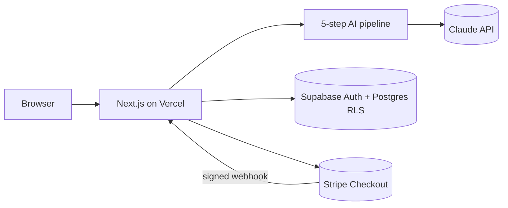

# Listing Copilot

**AI listing localization for cross-border sellers.** Sellers anywhere (China, Vietnam, Korea, Latin America…) selling on Amazon US and TikTok Shop US paste their product notes in their own language and get a US-ready title, five bullets, a description and backend search terms, then a compliance check that highlights wording likely to get the listing removed, with a reason and a one-click fix.

- **Live app:** https://listing-copilot-nine.vercel.app
- **Stack:** Next.js 15 · TypeScript · Tailwind · Supabase (Auth + Postgres/RLS) · Claude API · Stripe (test mode) · Vercel
- **Docs:** [PRD](docs/PRD.md) · [Architecture & design decisions](docs/ARCHITECTURE.md) · [Setup & deploy](docs/SETUP.md)

## What it does

| Step | What happens | How |
| --- | --- | --- |
| 1. Extract | Notes in any language (+ optional photo) → structured English facts. Too little information → 1-4 questions in the seller's language, **no credit spent** | Claude, structured output |
| 2. Keywords | Facts → phrases US shoppers actually search, and phrases to avoid | Claude |
| 3. Write | Title, 5 bullets, description, backend search terms in platform style | Claude |
| 4. Check limits | Length, forbidden characters, word repeats, bullet count, search-term bytes; one AI repair, then code enforces | TypeScript + Claude |
| 5. Review | Compliance: rule lexicon + AI review for implied claims. Grounding: anything the seller never said is marked *unconfirmed* | Code + 2 Claude calls in parallel |

Then the seller can fix a finding with AI, rewrite one section, edit by hand (re-checked on save), copy, or export CSV.

**Pricing:** 3 free listings · $4.99 for 20 credits · $9.99/month unlimited (Stripe Checkout, test mode: card `4242 4242 4242 4242`).

## Architecture



Details, sequence diagram and the reasoning behind each choice: [docs/ARCHITECTURE.md](docs/ARCHITECTURE.md).

## Repository layout

```
src/
  app/                     pages and API routes (Next.js App Router)
    api/listings/          generate (streamed progress), edit, rewrite, export
    api/checkout/          Stripe Checkout session
    api/stripe/webhook/    verified webhook → credits / Pro
    login/ dashboard/ listings/ pricing/
  lib/
    ai/                    pipeline.ts (5 steps), prompts.ts, claude.ts (SDK, retries, fallback), llm.ts (interface, errors)
    listing/               platforms, compliance lexicon, limit validator, input guard, types/schemas (no I/O)
    supabase/              user-scoped and service-role clients
    account.ts billing.ts  credits, rate limits, Stripe event → action
  middleware.ts            session refresh, route protection
supabase/migrations/       schema, RLS policies, credit and payment functions
tests/                     unit tests (fake model, no network)
docs/                      PRD, architecture, setup
```

## Reliability and safety

- **Errors never cost the seller:** a credit is spent only after step 1 succeeds and is refunded on any later failure.
- **Model output is validated:** JSON Schema structured outputs, zod validation, one retry, typed errors with user-facing messages.
- **Hallucination control:** grounding check against the extracted facts; AI compliance findings must quote text that is really in the listing.
- **Prompt injection:** seller text is data inside `<seller_input>`, instruction-like text is flagged, outputs are schema-bound, no tools.
- **Secrets:** server-side only (Vercel env vars); `.env.example` documents them. The browser never sees the Claude, Stripe or service-role keys.
- **Payments:** granted only by the signature-verified webhook, once per Stripe event; credit functions are not callable from the browser.
- **Abuse and cost:** per-user rate limits, rewrite cap per listing, token usage logged per step.

## Development

```bash
npm install
cp .env.example .env.local   # see docs/SETUP.md
npm run dev
npm run check                # type-check + lint + unit tests
npm run build
```

## Next steps

- Publish directly through the Amazon SP-API / TikTok Shop API.
- Replace estimated keywords with real search-volume data.
- A/B test title variants against conversion.
- More marketplaces (Amazon JP/EU) and bulk CSV upload.
- An eval set of real listings to tune prompts and measure compliance recall.
