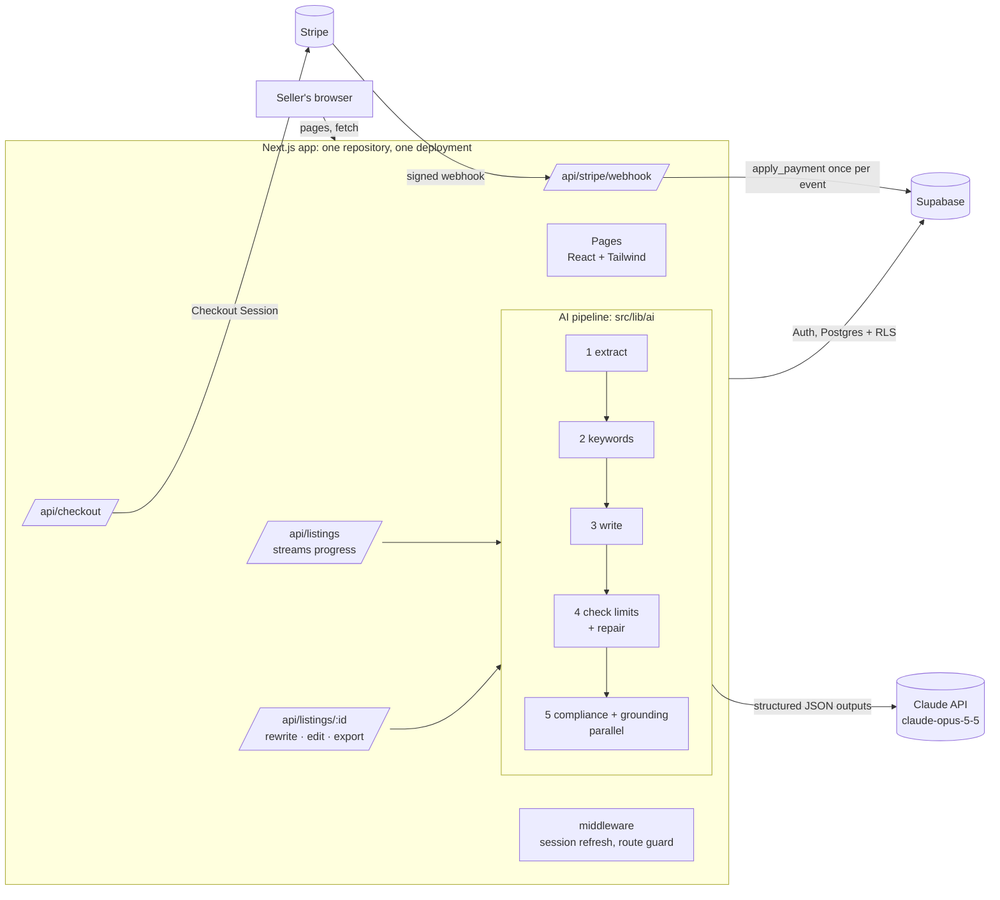
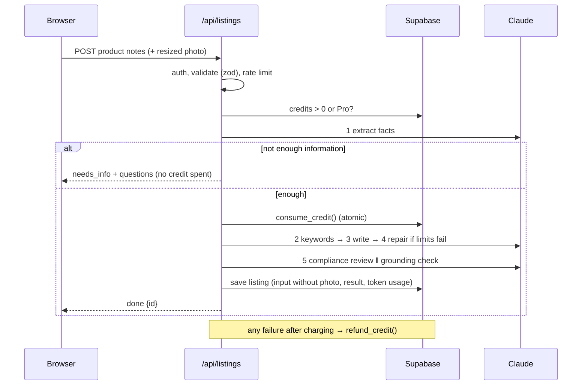

# Architecture

## System diagram

## Request flow: generating a listing

The response is newline-delimited JSON, so the page shows each step as it finishes.

## Layers

| Layer | Technology | Where |
| --- | --- | --- |
| Frontend | Next.js 15 App Router, React 19, Tailwind 4 | `src/app/**/page.tsx`, `src/components` |
| Backend | Next.js route handlers (Node runtime) | `src/app/api` |
| AI backend | Claude API via `@anthropic-ai/sdk`, structured outputs | `src/lib/ai` |
| Domain rules | Plain TypeScript, no I/O, unit-tested | `src/lib/listing` |
| Auth + data | Supabase Auth, Postgres with Row Level Security | `src/lib/supabase`, `supabase/migrations` |
| Payments | Stripe Checkout + webhook (test mode) | `src/app/api/checkout`, `src/app/api/stripe/webhook`, `src/lib/billing.ts` |
| Hosting | Vercel (push to `main` = deploy) | |

## Data model

| Table | Purpose | Who can write |
| --- | --- | --- |
| `profiles` | plan, credits, Stripe ids | server only, through `consume_credit`, `refund_credit`, `apply_payment` |
| `listings` | seller input (no photo) and the full result | server only; users read their own rows (RLS) |
| `generation_events` | every attempt: rate limiting, failures, token cost | server only |
| `payments` | one row per Stripe event: idempotency and audit | server only |

## Design decisions

1. **A pipeline of narrow steps, not one big prompt.** Each step has one job, its own schema and its own effort level (`low` for extraction and review, `medium` for writing). Failures are attributable to a step, the page can show progress, and a cheap step can stop the run early (missing information) before any credit is spent.

2. **Structured outputs + schema validation.** Every call sends a JSON Schema (`output_config.format`) generated from the same zod schema the code validates with. A truncated or invalid answer is retried once; a second failure is a typed `AIError` with a user-facing message.

3. **Rules in code, judgment in the model.** Platform limits (title length, forbidden characters, bullet count, search-term bytes) are checked and enforced in TypeScript; the model gets one chance to repair, then code trims. Compliance has two layers: a deterministic lexicon (stable, explainable, free) and an LLM review for implied claims the lexicon cannot see. AI findings are kept only if they quote text that is really in the listing.

4. **Grounding check against hallucinated specs.** A separate step compares the copy with the extracted facts and marks anything the seller never said ("waterproof") as *unconfirmed*, with a one-click removal.

5. **Money paths never trust the client.** Credits are spent with an atomic SQL function after step 1 succeeds, refunded on any later failure, and added only by the Stripe webhook after signature verification. Each Stripe event id is applied once, so retries are safe. Browser sessions cannot call these functions (`revoke execute`).

6. **Untrusted input.** Seller text is cleaned, wrapped in `<seller_input>` and described to the model as data. Instruction-like phrases are flagged to the user. Outputs are schema-constrained and the model has no tools, so injected text cannot change the format or trigger actions. Inputs have length limits; photos are resized in the browser and not stored.

7. **Cost and abuse controls.** Per-user rate limits (4 generations a minute, 60 a day), 10 AI rewrites per listing, token usage recorded per step for every listing.

8. **Refusals.** Requests opt into server-side fallback (`fallbacks: "default"`): if a safety classifier declines, the API retries on Anthropic's recommended fallback model; a final refusal becomes a clear message and a refund.
